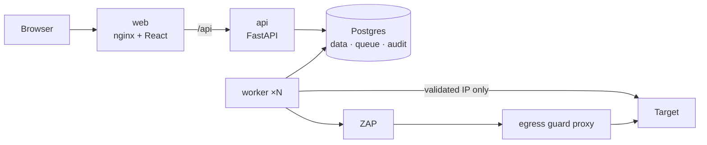

# Pre-Assessment Console

A self-hosted web app that lets a team run **safe, early security checks on their own websites and APIs** before formal security testing.

Owners register a target, the platform confirms it is allowed to be scanned, and a queued worker runs the checks. Owners then get findings with evidence and fix guidance, and can produce a report for management or for engineers.

> **Pre-assessment aid only.** This is not a penetration test, certificate or clearance. Scan only systems you own or are authorised to test.

## What it does

- **Three scan profiles.**
  - **Quick:** reachability, open ports (nmap), TLS, security headers and cookies, exposed files such as `/.git` and `/.env`, and technology fingerprinting.
  - **Pre-Assessment** and **Deep:** add crawling, signed-in testing with test accounts, access-control checks, API and CMS checks, and an OWASP ZAP scan within a time and request budget.
- **Findings you can act on.** Each finding shows severity and confidence separately, plus its location, redacted evidence, steps to reproduce and a fix. Findings are de-duplicated across scans. Mark one as a false positive or an accepted risk (a reason is required), and after fixing, **retest only the findings you fixed**.
- **Reports.** Management and technical reports in the browser and as PDF.
- **A queue that protects the network.** Scans wait in a queue backed only by Postgres. A global limit (1 active scan by default, an admin can raise it to 3) holds across any number of workers. Priority with aging keeps low-priority scans from waiting forever, and equal priority runs first in, first out. A crashed worker's scan becomes *Interrupted*, and its partial results are kept.
- **Admin console.** Users and roles, approvals, scan capacity, scan profiles, an append-only audit log, and versioned **target policies**: draft, then validate, then dry run, then publish, with roll back.

## Safety model

Scanning other people's servers by mistake is the main risk, so most of the design is about preventing it.

- **Every target is validated before any traffic is sent.**
  - The URL is normalised, and odd IP spellings such as `2130706433` or `0x7f.1` are rejected.
  - DNS is resolved, and **every** returned address is checked.
  - Redirects are followed one hop at a time, and each hop is checked again.
  - Ports and policy rules are checked last.
- **Some ranges can never be scanned, whatever the policy says:** loopback, link-local, cloud metadata (`169.254.169.254`), multicast, reserved and CGNAT. Private addresses need an explicit admin rule.
- **Protection against DNS rebinding.** Workers connect to the address that was validated, and resolve the name again at scan time. ZAP has no direct internet access: it can only reach out through a guard proxy that applies the same checks to every connection.
- **Test-account passwords are sealed** with X25519, HKDF and AES-GCM. The API holds only the public key, so it can store passwords but never read them back. Only the worker can decrypt.
- **Accounts:** Argon2id passwords, mandatory TOTP MFA, HttpOnly SameSite=Strict sessions, CSRF protection and login throttling.
- **Access to records:** Missing records and records you can't access both return 404, so their existence isn't revealed. Every state change is written to an audit log that the app's own database role cannot edit or delete.

## Architecture



FastAPI, SQLAlchemy 2, Alembic and Postgres 16 on the backend; React 18, TypeScript and Vite on the frontend. Everything runs in Docker Compose, so the images you test on a laptop are the ones you deploy.

## Quick start

You need Docker with at least 5 GB of memory (ZAP needs about 1.6 GB).

```bash
cp .env.example .env    # then replace every change-me value
docker-compose run --rm --no-deps worker python -m app.cli gen-credential-keys   # paste both lines into .env
docker-compose --profile dev --profile dast up -d --build --scale worker=2
docker-compose exec api python -m app.cli create-admin --email you@example.com --name "You"
```

1. Open **http://localhost:8080**.
2. Sign in with the temporary password that was printed.
3. Scan the QR code with an authenticator app.

The `dev` profile adds two deliberately weak practice targets (`testtarget` and `testportal`), so you can see real findings straight away.

## Tests

```bash
docker-compose --profile test run --build --rm test          # backend (pytest)
cd frontend && npx tsc --noEmit && npm test                    # frontend (vitest)
docker-compose exec -T worker python /app/scripts/e2e_phase3.py  # end-to-end scan (needs the Quick start stack, dev + dast); ends with RESULT ALL PASS
```

## Deploying to a server

- Put a TLS terminator in front of `web`, and set `APP_ENV=prod` and `COOKIE_SECURE=true` (without TLS, browsers drop the cookie and sign-in fails).
- Start with `docker-compose --profile dast up -d --build --scale worker=2`, **without** the `dev` profile. Without `dast`, ZAP doesn't start and the Pre-Assessment and Deep profiles can't run.
- Use long random secrets. The api and worker refuse to start while `SECRET_KEY`, `APP_DB_PASSWORD`, `ZAP_API_KEY` or `EGRESS_TOKEN` is still a `change-me` placeholder; `POSTGRES_PASSWORD` is not checked, so change it yourself.
- Back up `CREDENTIALS_PRIVATE_KEY`. Losing or changing it makes every saved test account unreadable.
- Never run `docker-compose down -v` on a server, because it deletes the database volume.

## Documentation

- [Architecture, data model and threat model](docs/ARCHITECTURE.md)
- [API reference](docs/API.md)
- [Design system](DESIGN_SYSTEM.md)
- [Backlog](docs/BACKLOG.md)

## License

[MIT](LICENSE)
